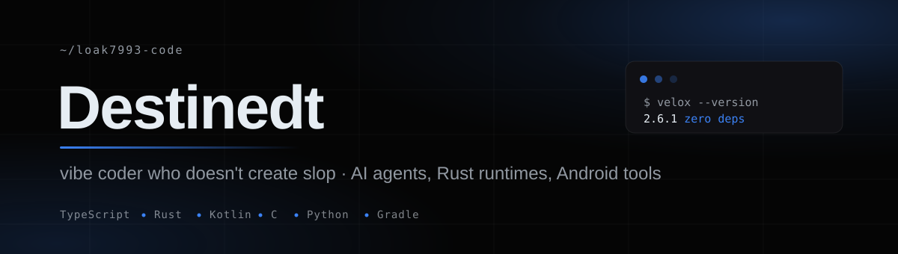
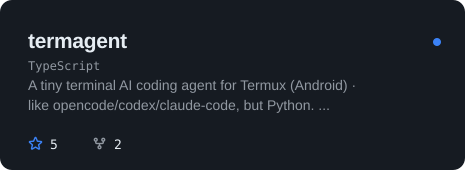
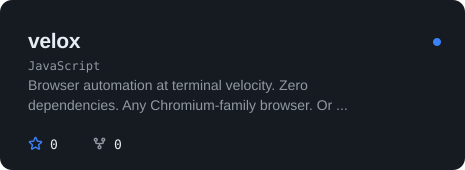
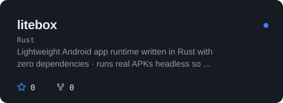
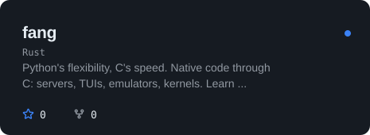
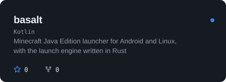
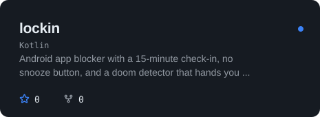
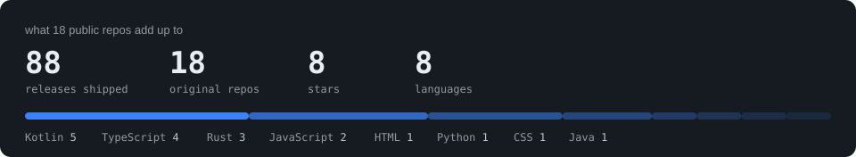

  

### what I ship

Small, sharp tools that work on first contact. Terminal AI agents, browser automation, Rust runtimes that execute real Android APKs, and Android apps with actual opinions. Everything here builds, runs, and has docs.

### featured

<table>
  <tr>
    <td width="50%">
      
    </td>
    <td width="50%">
      
    </td>
  </tr>
  <tr>
    <td>
      
    </td>
    <td>
      
    </td>
  </tr>
  <tr>
    <td>
      
    </td>
    <td>
      
    </td>
  </tr>
</table>

### the rest of the toolbox

| project | what it does |
| --- | --- |
| [velox-grid](https://github.com/loak7993-code/velox-grid) | automation as a service: job API, worker fleet, Postgres queue |
| [kestrel](https://github.com/loak7993-code/kestrel) | browser automation at native speed, embedded QuickJS scripting |
| [ghostframe](https://github.com/loak7993-code/ghostframe) | coherent-fingerprint browser automation, one identity across every layer |
| [vaultpdf](https://github.com/loak7993-code/vaultpdf) | offline PDF toolkit in a single HTML file, zero uploads |
| [lumen-browser](https://github.com/loak7993-code/lumen-browser) | lightweight private Android browser, ad and tracker blocking |
| [tide](https://github.com/loak7993-code/tide) | Android launcher built around moving water and caustic light |
| [streamviva-android](https://github.com/loak7993-code/streamviva-android) | fully native streaming app, Kotlin + Compose, no WebView |
| [streamviva-webos](https://github.com/loak7993-code/streamviva-webos) | streaming for LG webOS TVs, D-pad native, pure vanilla JS |
| [captcha-solver](https://github.com/loak7993-code/captcha-solver) | CPU-only CRNN and CLIP solvers at 99% accuracy |
| [nova-ai](https://github.com/loak7993-code/nova-ai) | privacy-focused Android AI chat client with tool calling |
| [openmuse](https://github.com/loak7993-code/openmuse) | personal agent with its own browser, terminal, and files |

### numbers

  

### find me

[blog](https://destinedt.cyou) · [telegram](https://t.me/monk)
